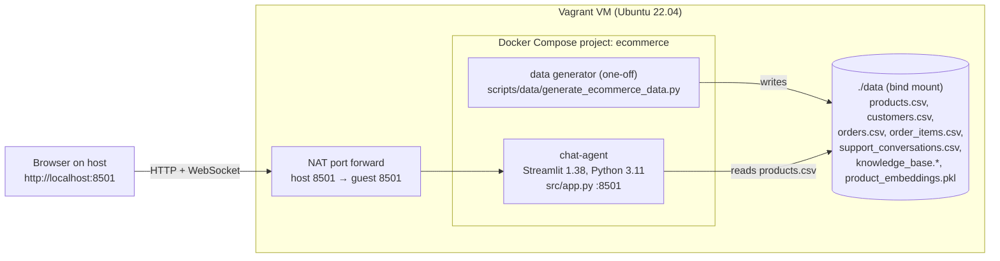

# Module 01 — Architecture

State of the system as deployed for Module 01. Everything here was verified on the running stack; planned components are listed separately at the end.

## Environment

| Layer | What |
|---|---|
| Host | Ubuntu laptop, VirtualBox 7.0 + Vagrant 2.4 |
| VM | `bento/ubuntu-22.04`, 4 vCPU, 8 GB RAM, 60 GB disk |
| Runtime | Docker 29.9, Docker Compose v5.7 |
| Project | `~/ecommerce` in the VM, one Compose service |

## Diagram

## Services

| Service | Image | Port | Role | Health |
|---|---|---|---|---|
| `chat-agent` | built from `docker/Dockerfile` (`python:3.11-slim`, 862 MB) | 8501 | Streamlit chat UI: keyword search over the product catalogue | `GET /_stcore/health` → `ok` |
| data generator | same image, run once with `docker compose run` | — | Creates the synthetic dataset in `data/` (seed 42, reproducible) | exit code 0 |

`chat-agent` is the only long-running service in Module 01. It is stateless: chat history lives in the Streamlit session (browser tab), nothing is written to disk.

Compose settings worth knowing:

- `.:/app` is bind-mounted, so code changes in `src/` apply without rebuilding the image.
- `restart: unless-stopped` brings the service back after a VM reboot.

## Data flow

1. **Generation (once).** The generator writes 500 products, 5 000 customers, 10 000 orders (18 836 items), 1 960 support conversations and 8 knowledge-base articles into `data/`. These files are git-ignored.
2. **Startup.** Streamlit starts `src/app.py`; on the first request it loads `data/products.csv` into a pandas DataFrame and caches it (`st.cache_data`).
3. **Request.** The browser opens `/`, receives the static Streamlit front end and then talks to the server over a WebSocket (`/_stcore/stream`).
4. **Search.** A chat message is lower-cased and matched as a substring against `name`, `category` and `description`. The first five matches are returned with name, category and `final_price`.
5. **Response.** The answer is rendered in the chat and appended to the session history.

Only `products.csv` is used by the application today. The other files are inputs for later modules.

## Endpoints

| Endpoint | Purpose |
|---|---|
| `GET /` | Web UI |
| `GET /_stcore/health` | Liveness check, returns `ok` |
| `GET /_stcore/host-config` | Front-end configuration (JSON) |
| `WS /_stcore/stream` | Chat session traffic |

Streamlit answers unknown paths with the UI page and HTTP 200, so a 404 check is not a usable signal for this service.

## Planned components (not deployed yet)

The repository contains empty placeholders for later modules: `services/ml-service` (8001), `services/rag-service` (8002), `services/agent-service` (8003), `services/api-gateway`, MLflow (5000), Prometheus (9090), Grafana (3000), Airflow. Their Dockerfiles and Compose files are 0 bytes, so they are not part of this architecture yet.
